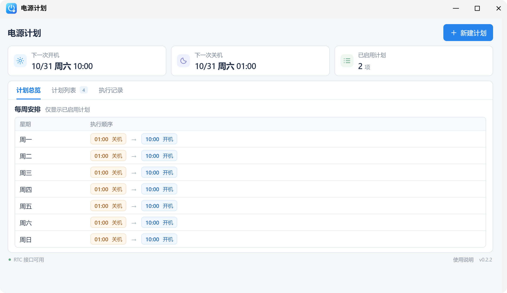
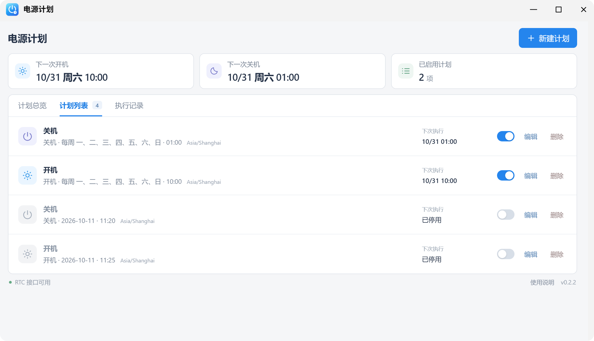
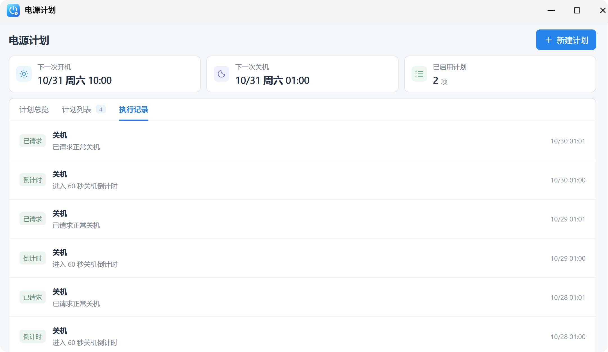
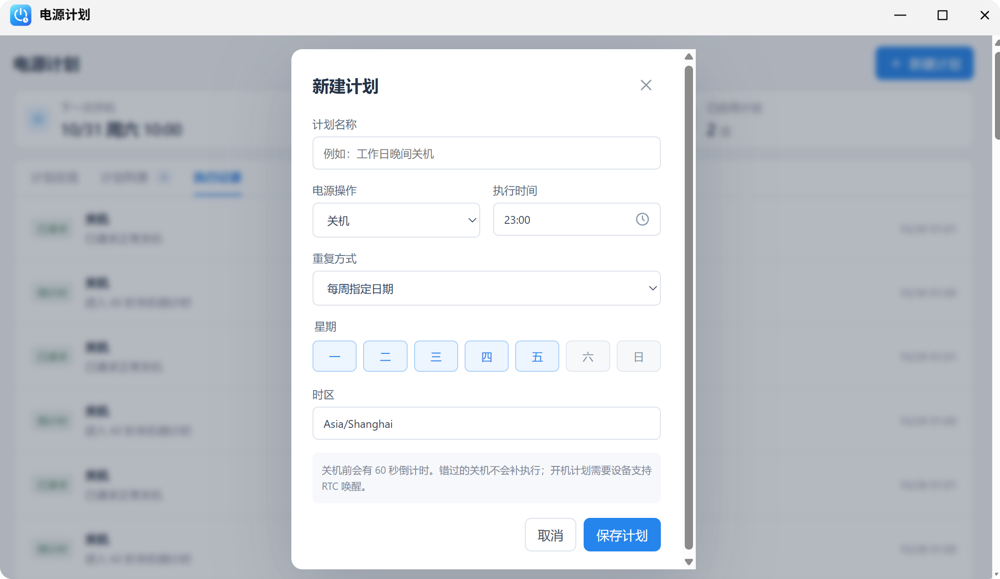

# 电源计划 · fnOS Power Scheduler

**让飞牛 NAS 按你的时间表自动关机、自动开机。**

「电源计划」是一款面向 [飞牛 fnOS](https://www.fnnas.com/) 的第三方应用。不用写脚本，也不用配置定时任务，在网页里就能设置 **单次、每天、每周** 的开关机计划，一天还可以安排多次。

**[⬇️ 下载最新版 FPK](https://github.com/Simlym/fnos-power-scheduler/releases/latest/download/fnos-power-scheduler.fpk)** · [查看所有版本](https://github.com/Simlym/fnos-power-scheduler/releases) · [反馈问题](https://github.com/Simlym/fnos-power-scheduler/issues)

> **先了解一件事：** 自动关机由 fnOS 执行；自动开机依靠主板的 **RTC 定时唤醒** 功能。不是所有 NAS 硬件都支持自动开机，请先阅读下方的[兼容性说明](#使用前必读)。

## 能做什么？

- **定时关机**：到点提醒，60 秒倒计时内可以取消本次关机。
- **定时开机**：提前设置主板 RTC 闹钟，关机后也有机会按计划自动唤醒。
- **灵活重复**：仅执行一次、每天执行、每周指定星期；支持一天内多组开关机。
- **计划一目了然**：在「计划总览」查看每周安排和下一次开机、关机时间。
- **发现冲突**：对重复计划、同一时间开关机、开关机间隔太短等情况给出提示。
- **可管理、可追踪**：在「计划列表」启用、停用、编辑或删除规则；在「执行记录」查看结果。

### 一个实际例子

假设希望 NAS **工作日早上自动开机、晚上自动关机**，只需要添加两条计划：

| 计划名称 | 操作 | 重复方式 | 时间 |
| --- | --- | --- | --- |
| 工作日开机 | 开机 | 每周一至周五 | 07:30 |
| 工作日晚间关机 | 关机 | 每周一至周五 | 23:30 |

如果你还想周末采用另一套时间，可以继续新增计划；不必编写 crontab，也不需要手动维护多个脚本。

## 界面截图

| 计划总览 | 计划列表 |
| --- | --- |
|  |  |

| 执行记录 | 新建计划 |
| --- | --- |
|  |  |

## 下载安装

**适用系统：fnOS x86_64，最低版本 1.1.3100。** 当前尚未上架飞牛应用中心，需要手动安装。

1. 打开 [Releases 下载页面](https://github.com/Simlym/fnos-power-scheduler/releases/latest)，下载附件 **`fnos-power-scheduler.fpk`**。
2. 在 fnOS 的应用管理页面，使用**手动安装**功能选择刚下载的 FPK 文件。
3. 安装完成后，打开应用「**电源计划**」。
4. 点击右上角「**新建计划**」，设置开机或关机时间并保存。

> 提示：请下载 Release **Assets** 中的 `.fpk`，不要下载 GitHub 自动生成的 `Source code.zip`（那是源码，不能作为应用安装）。每个发布版本还提供 SHA256 校验文件。升级前建议备份应用数据。

## 第一次怎么设置？

以“周一至周五 23:30 关机”为例：

1. 点击「**新建计划**」。
2. **计划名称**填写“工作日晚间关机”。
3. **电源操作**选择“关机”，**执行时间**设为 `23:30`。
4. **重复方式**选择“每周指定日期”，勾选周一至周五。
5. 检查**时区**，例如中国大陆使用 `Asia/Shanghai`，然后点击「**保存计划**」。

保存后，你可以通过页面完成这些操作：

| 页面位置 | 用来做什么 |
| --- | --- |
| **计划总览** | 按星期查看安排；确认下一次开机、关机时间 |
| **计划列表** | 启用、停用、编辑、删除计划 |
| **执行记录** | 查看倒计时、取消、跳过及执行失败等记录 |

建议第一次**先创建一个即将触发的关机测试计划**，验证 60 秒倒计时及“取消本次关机”按钮，再在确认无重要任务运行时测试真实关机和自动开机。

## 使用前必读

自动关机与自动开机的实现方式不同：

| 功能 | 工作原理 | 需要注意 |
| --- | --- | --- |
| 定时关机 | fnOS 的 systemd timer 到点触发关机流程 | 关机前有 60 秒取消机会；错过时间不会补关机 |
| 定时开机 | 系统提前向主板 RTC 写入下一次唤醒时间 | 必须有硬件和固件支持；不同主板需实际测试 |

特别注意：

- **RTC 兼容性决定能否自动开机。** 主板 BIOS/UEFI 必须支持关机状态下的 RTC 唤醒，关机后也要保持供电。某些 BIOS 内置的固定 RTC 闹钟设置可能与系统写入的闹钟冲突。
- **目前仅支持 UTC 硬件时钟。** 如果设备将硬件时钟配置为 `LOCAL`，应用会拒绝写入 RTC 并显示错误，避免出现错误的唤醒时间。
- **不要把自动关机安排在重要任务进行时。** 目前不会自动识别 Docker、下载、备份或存储维护任务，请自行避开这些时段。
- **计划应用失败需要处理。** 如果页面提示“计划尚未完全应用”，请检查错误信息；修复设备问题后，重新保存计划以重试。

项目曾在 **Cloudstar ITX-C246** 设备上完成真实关机和 RTC 开机测试；**这不代表其他主板均能成功唤醒**。建议先测试，再用于长期无人值守。

## 常见问题

### 关闭网页以后，计划还会执行吗？

**会。** 已成功应用的计划由系统调度，不依赖网页一直打开。

### 在 fnOS 中停止应用，就能暂停自动开关机吗？

**不能。** 停止应用会取消当前正在进行的关机倒计时，但已应用的定时规则仍可能继续执行。要暂停，请先到「计划列表」**停用全部计划**。

### 关机以后，软件不是停止了吗？怎么还能自动开机？

应用会在关机前将下一次唤醒时间写入主板 **RTC 硬件闹钟**。如果硬件支持，即使操作系统已经关闭，主板仍可按预设时间唤醒设备。它不是通过后台程序“在关机后运行”。

### 为什么定时关机正常，但没有自动开机？

优先确认主板是否支持 RTC 唤醒、BIOS/UEFI 设置是否与系统闹钟冲突、设备是否持续供电，以及页面是否显示 RTC 写入失败。不同设备的 BIOS 选项名称不一致，不能保证所有机型都兼容。

### 到点了却没有关机，是不是漏执行了？

应用有安全保护：系统启动或应用启动后的短时间内会跳过关机；关机前若 RTC 设置或读回检查失败，也可能为避免设备无法按计划再开机而取消关机。请查看「执行记录」和页面错误信息。错过的关机不会补执行。

### 卸载会怎样？

卸载会清理本应用创建的定时器，以及仍由本应用拥有的 RTC 闹钟。卸载前建议先禁用计划，并按需备份应用数据。

## 项目状态与开发

- **当前状态**：开发阶段，GitHub 发布版本不代表已通过飞牛应用中心审核。
- **技术栈**：Rust（后台与电源控制）+ Vue（管理界面）+ SQLite（计划及执行记录）。
- **本地开发**：支持模拟模式，可查看和管理规则；模拟模式**不会真正关机、设置 RTC 或安装系统 timer**。
- **开发文档**：[构建安装包、实现原理、权限设计、设备验收和 CI/CD](docs/development.md)。

欢迎通过 [Issues](https://github.com/Simlym/fnos-power-scheduler/issues) 反馈硬件兼容问题或功能建议。反馈时可附上 fnOS 版本、主板型号、计划设置与错误信息（请勿公开敏感数据）。

许可证尚待确定。
